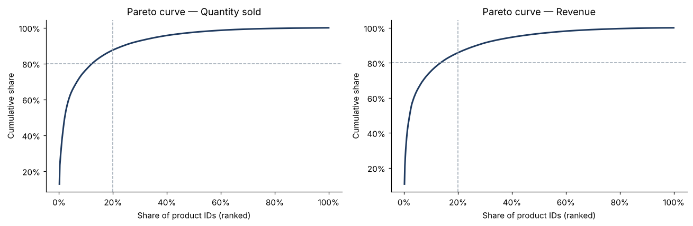
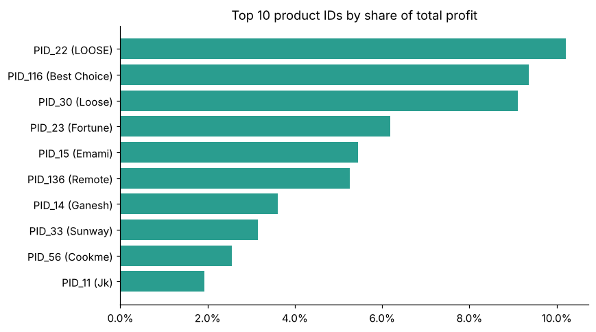
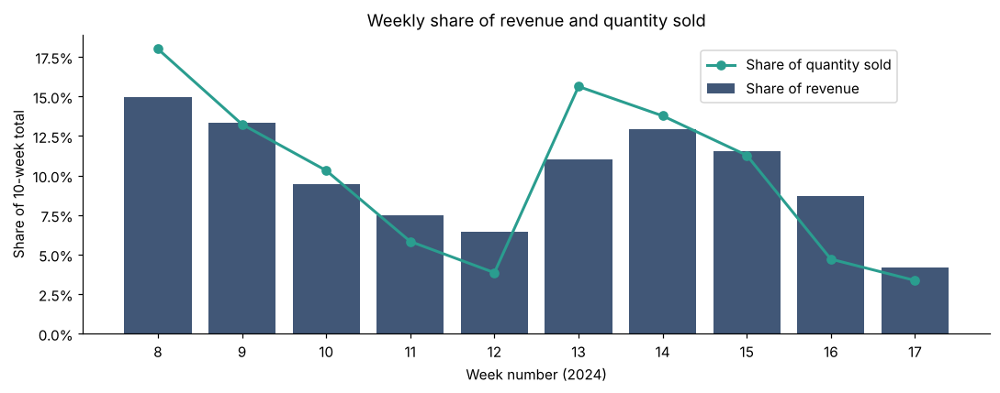
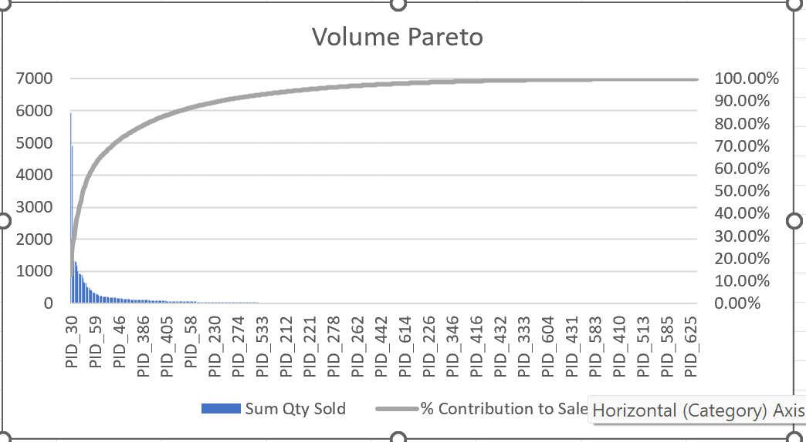
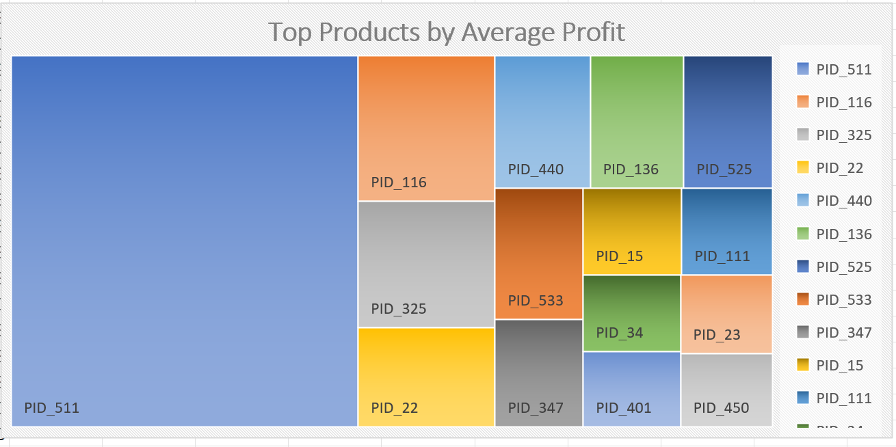
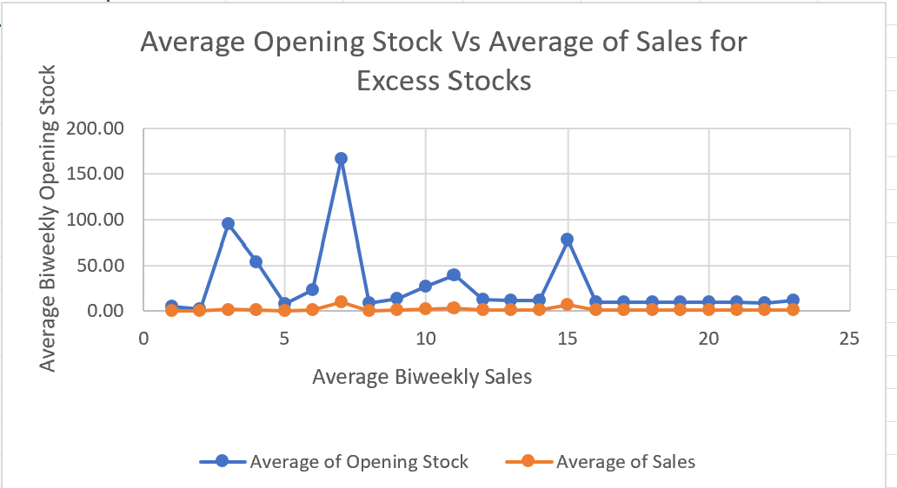
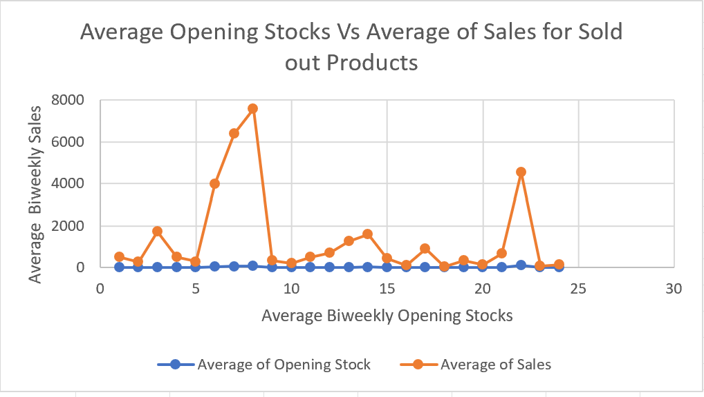
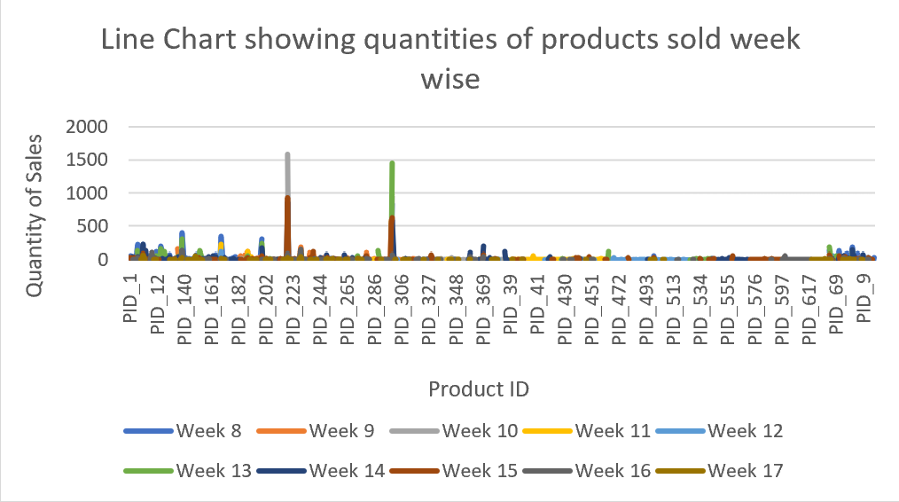
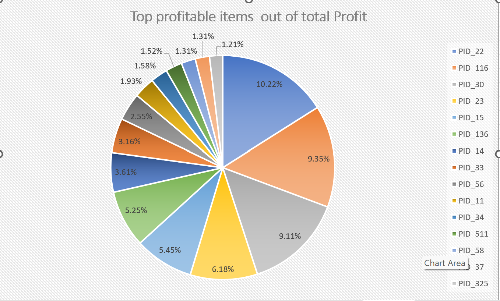

# Redstart Canteen — Sales & Inventory Analysis

Data-driven inventory optimisation and student engagement for a campus grocery store at IIT Mandi.
Capstone project for the *Business Data Management* course, IIT Madras BS in Data Science.

The analysis was done in **Excel** (pivot tables, Pareto charts, sales forecasting, inventory ratios) on ten weeks of real sales and inventory records collected from the store. A **Python notebook** in this repository reproduces the core analysis from the same data.

## Problem

Redstart Canteen opened in January 2024 on IIT Mandi's Kamand campus, about 14 km from Mandi town, and serves students, PhD scholars and faculty. It faced two problems:

1. **Inventory imbalance.** High-demand items were often out of stock, causing lost sales, while slow-moving items were overstocked. The store's hillside location makes quick restocking harder.
2. **Market reach.** The store wanted to become the preferred store for the campus community by better understanding customer needs.

## Data

| Source | Contents |
|---|---|
| Sales records | 4,961 daily product-level sales records (one row = one product's sales on one day), 19 Feb – 26 Apr 2024 (weeks 8–17): date, product, brand, sub-category, quantity, MRP, cost price, revenue, profit, payment method |
| Inventory records | Opening stock, sales, inward stock and closing stock per product ID for five two-week periods |

The data covers 632 product IDs (2,274 product names) across 91 sub-categories. Each product ID groups one brand's items. Quantity is counted in pieces for packaged goods and in kg for loose items such as rice, pulses and sugar. Revenue = quantity × MRP.

## Approach

| Analysis | Question it answers |
|---|---|
| Pareto analysis | Which products drive most of the volume and revenue? |
| Sales forecasting | What demand should the store plan stock for? |
| Profit contribution | Which products earn most of the profit? |
| Weekly trends | When does demand peak, and why? |
| Inventory ratio (average opening stock ÷ average sales) | Which products are understocked or overstocked? |
| Revenue–volume segmentation | Which products to keep in stock, and which to market? |

## Key findings

**The business in ten weeks:** 68 trading days, 46,241 units/kg sold, a 13.3% profit margin on revenue, and 95.5% of quantity sold paid by UPI. Staples such as rice, cooking oil, atta and pulses drive most of the revenue.

1. **Sales are highly concentrated.** 86 of 632 product IDs (13.6%) generate 80% of revenue, and 78 (12.3%) generate 80% of quantity sold. Staples such as rice, lentils, flours, powdered spices and instant noodles lead.

   

2. **Profit is concentrated too.** The top three product IDs (branded and specialty rice, Best Choice soybean oil, loose essential commodities) earn 28.7% of total profit. Cooking oils feature heavily among the top earners.

   

3. **Demand follows the academic calendar.** Revenue peaks in week 8 (pre-exam), dips in weeks 11–12, and rebounds in week 13 (campus events). Some products are seasonal: light moisturiser and shaving needs peak in March.

   

4. **Fast sellers are understocked; slow movers are overstocked.** Cooking oils, MamyPoko pants, Horlicks and Whisper start periods with very little stock relative to sales. Tresemme conditioner, Lays and Yoga Bar have high stock but low sales.

5. **Segments guide action.** High-volume, low-revenue items (e.g. Tata Tea) bring customers in; low-volume, high-revenue items (e.g. poppy seeds, olive oil) are candidates for targeted marketing.

## Recommendations

- **Stock the right items:** seasonal planning, stronger supplier relationships, better product placement for slow movers
- **Serve customers better:** customer segmentation, early-morning delivery of essentials, a loyalty programme
- **Price and operate smartly:** competitive pricing, sustainability practices

## Original Excel analysis

Screenshots of the charts built in the original Excel workbook.

| Volume Pareto | Top products by average profit |
|---|---|
|  |  |

| Excess stock: average opening stock vs. sales | Sold-out products: average opening stock vs. sales |
|---|---|
|  |  |

| Weekly quantity sold by product | Top products by share of profit |
|---|---|
|  |  |

## Data availability

The sales and inventory data belong to the store and include its cost prices and margins, so **the raw data is not published**. The notebook is shared with all its outputs so the analysis can be reviewed without the data.

**Data dictionary (sales records):** `DATE`, `PRODUCT NAME`, `PRODUCT ID`, `BRAND`, `SUB CATEGORY`, `QUANTITY SOLD`, `MRP`, `COST PRICE`, `REVENUE`, `PROFIT`, `WEEK NUMBER`, `DAY`, `PAYMENT METHOD`

**Data dictionary (inventory records):** `Product`, `Opening Stock`, `Sales`, `Inward Stock`, `Closing Stock`, `Weeks` (two-week period)

## Repository structure

```
redstart-canteen-inventory-analysis/
├── notebooks/
│   └── redstart_analysis.ipynb   # Python reproduction of the Excel analysis, with outputs
├── presentation/
│   └── redstart_canteen_findings.pdf     # findings deck
├── images/                       # charts used in this README
├── requirements.txt
└── README.md
```

## Notes

- In the original workbook, opening and closing stock for weeks 14–15 were linked to an external file and show as errors. The notebook computes inventory ratios from the remaining four periods, so its values can differ slightly from the original Excel pivot.
- The Python notebook was written after the project, to reproduce the original Excel analysis in code.

## Tools

Excel (pivot tables, charts), Python, pandas, NumPy, Matplotlib
